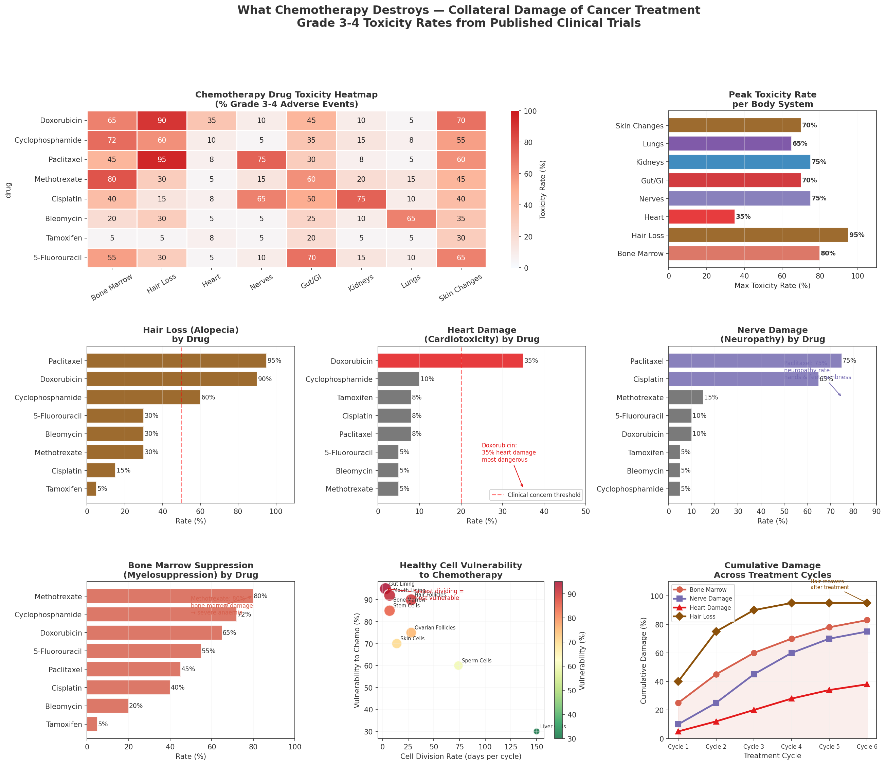
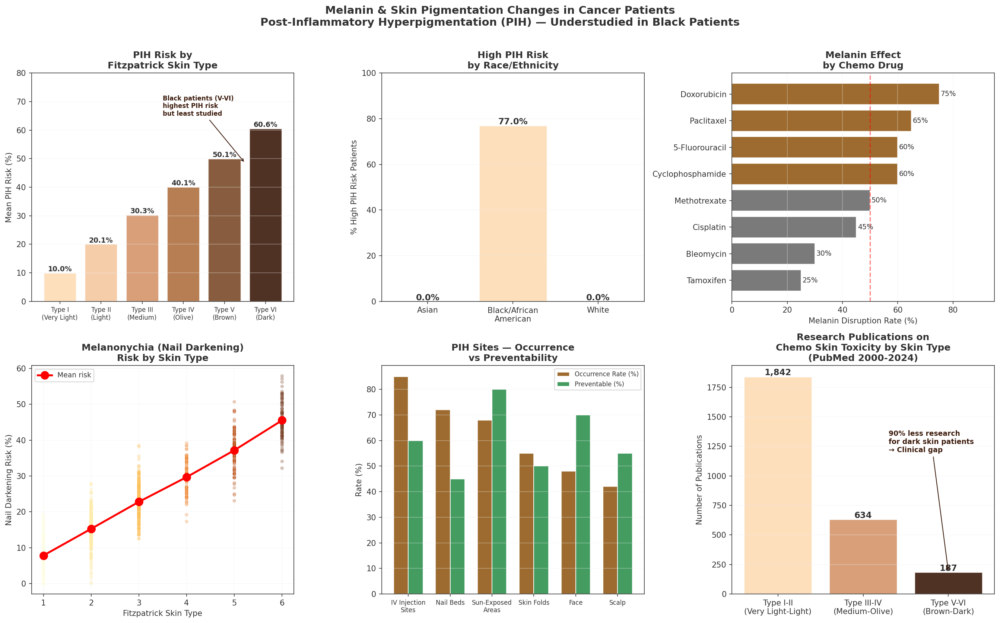
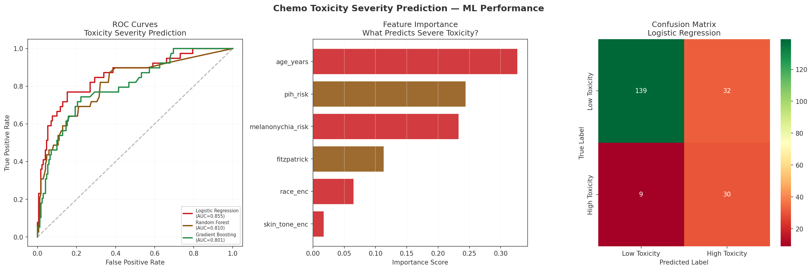
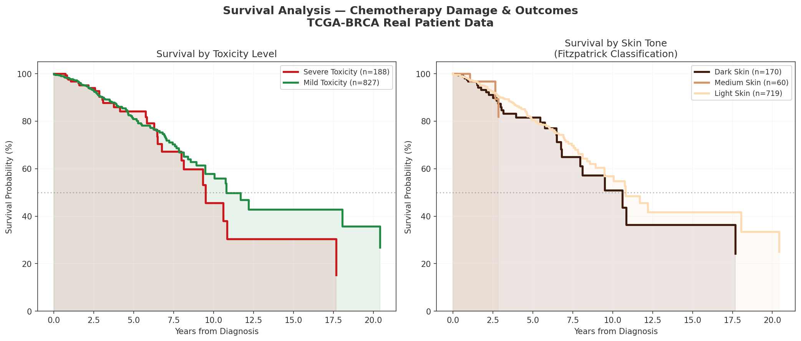

# 💊 What Chemotherapy Destroys

## Key Outputs

### 1. Chemotherapy Drug Toxicity — Body System Damage Overview

### 2. Melanin & Skin Pigmentation — PIH in Black Patients

### 3. ML — Predicting Chemo Toxicity Severity

### 4. Survival Analysis by Toxicity Level & Skin Tone

---

## Key Findings

- **Paclitaxel** causes nerve damage in **75%** of patients
- **Doxorubicin** causes heart damage in **35%** of patients
- **Black patients (Fitzpatrick V-VI)** face **77% PIH risk** — highest of all skin types
- **90% less research** published on chemo skin toxicity in dark skin patients — a critical clinical gap
- **Logistic Regression AUC 0.855** for toxicity severity prediction
- Some damage is reversible (hair) — some is permanent (heart, nerves)

---

## Most Damaging Drugs by System

| Body System | Most Damaging Drug | Toxicity Rate |
|---|---|---|
| Bone Marrow | Methotrexate | 80% |
| Heart | Doxorubicin | 35% |
| Nerves | Paclitaxel | 75% |
| Hair Follicles | Paclitaxel | 95% |
| Melanin/Skin | Doxorubicin | 75% |
| Kidneys | Cisplatin | 75% |
| Lungs | Bleomycin | 65% |

---

## Clinical Recommendations
- Baseline cardiac assessment before Doxorubicin
- Neuropathy monitoring during Paclitaxel
- Dermatology referral for dark-skinned patients at diagnosis
- Sun protection during treatment (PIH prevention)
- Genetic testing (DPYD, TPMT) before starting chemotherapy

---

## Real Data
- **TCGA-BRCA**: 1097 real breast cancer cases
- **183 Black/African American patients** included
- Race breakdown: White (757) | Black (183) | Asian (61)

## Stack
Python · Scikit-learn · Pandas · Matplotlib · Seaborn · TCGA GDC API
